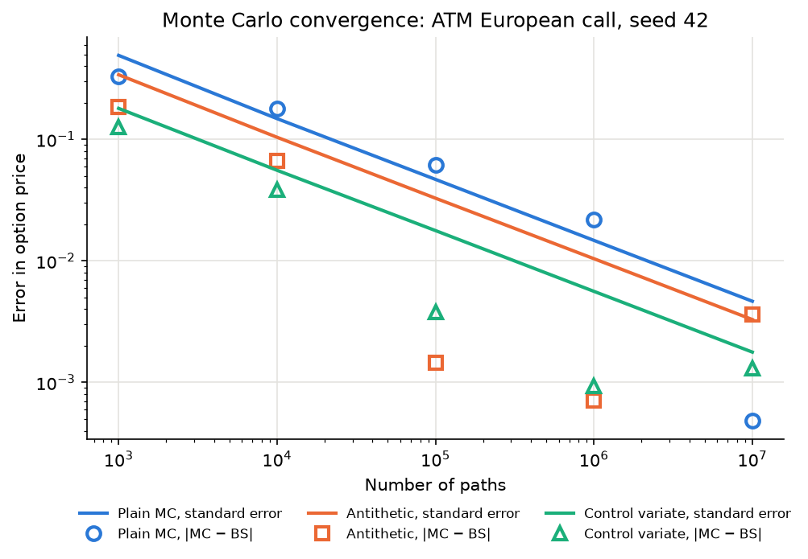

# optionpricer

[](https://github.com/sameed102/Option-Pricing-Library/actions/workflows/ci.yml)

A small C++17 library for pricing European and Asian options, with each Monte Carlo result checked against the closed-form Black-Scholes answer:

- **Black-Scholes closed form**: exact prices, analytic delta, gamma and vega, and implied volatility by Newton's method.
- **Monte Carlo** under geometric Brownian motion: a price estimate with its standard error, and an optional seed for reproducible runs.
- **Two variance-reduction methods** on the Monte Carlo pricer:
  - **antithetic variates**, which halve the variance
  - **a control variate** (the discounted stock price), which cuts it about 7×
- **Monte Carlo Greeks, two ways**:
  - **bump-and-reprice** with common random numbers, shown next to independent seeds to explain why common random numbers matter
  - **pathwise derivatives**
- **An arithmetic-average Asian option**, priced by stepping through time.
- **A convergence study**: Monte Carlo error at 1e3 to 1e7 paths, written as CSV and plotted on log-log axes.
- **Unit tests** run through CTest, and GitHub Actions runs them on every push.

The C++ uses only the standard library (`<cmath>`, `<random>`) and builds with CMake. The plot script uses Python and matplotlib.

## Layout

```
include/black_scholes.hpp    OptionType, OptionParams, Black-Scholes prices, Greeks, implied_vol
src/black_scholes.cpp
include/monte_carlo.hpp      MCResult, mc_price (plain / antithetic / control variate), mc_asian_price
src/monte_carlo.cpp
include/bump_greeks.hpp      Greeks, mc_greeks (bump-and-reprice)
src/bump_greeks.cpp
include/pathwise_greeks.hpp  PathwiseGreeks, mc_pathwise_greeks
src/pathwise_greeks.cpp
apps/bs_example.cpp          Black-Scholes prices and Greeks, implied-vol round trip
apps/mc_example.cpp          Monte Carlo vs Black-Scholes for one option
apps/convergence.cpp         Monte Carlo error at 1e3 ... 1e7 paths, as CSV
apps/greeks_example.cpp      bump (with and without CRN) and pathwise Greeks vs analytic
apps/asian_example.cpp       Asian call for 1, 12, 52 and 252 monitoring dates
tests/test_main.cpp          unit tests, run through CTest
scripts/plot_convergence.py  log-log plot of convergence.csv
.github/workflows/ci.yml     builds and runs the tests on every push
```

## Build and run

Requires CMake 3.14 or newer and a C++17 compiler. The build defaults to Release, because Monte Carlo runs slowly in Debug.

```bash
cmake -S . -B build
```

```bash
cmake --build build
```

```bash
./build/bs_example
```

```bash
./build/mc_example
```

```bash
./build/convergence > convergence.csv
```

```bash
./build/greeks_example
```

```bash
./build/asian_example
```

Run the unit tests (or run `./build/tests` to see every check):

```bash
ctest --test-dir build
```

Plot the convergence CSV (needs Python 3 with matplotlib):

```bash
python3 scripts/plot_convergence.py convergence.csv convergence.png
```

## Formulas

Inputs: spot $S$, strike $K$, risk-free rate $r$ (continuously compounded), volatility $\sigma$, time to expiry $T$ in years. $N$ is the standard normal CDF and $\varphi$ its density.

### Black-Scholes

$$d_1 = \frac{\ln(S/K) + (r + \tfrac{1}{2}\sigma^2)T}{\sigma\sqrt{T}}, \qquad d_2 = d_1 - \sigma\sqrt{T}$$

| Quantity | Call | Put |
|---|---|---|
| Price | $S N(d_1) - K e^{-rT} N(d_2)$ | $K e^{-rT} N(-d_2) - S N(-d_1)$ |
| Delta $\partial V/\partial S$ | $N(d_1)$ | $N(d_1) - 1$ |
| Gamma $\partial^2 V/\partial S^2$ | $\dfrac{\varphi(d_1)}{S\sigma\sqrt{T}}$ | same |
| Vega $\partial V/\partial \sigma$ | $S\varphi(d_1)\sqrt{T}$ | same |

Vega is per 1.00 change in $\sigma$. Divide by 100 to get the per-vol-point figure traders quote.

$N(x)$ is computed as $\tfrac{1}{2}\,\mathrm{erfc}(-x/\sqrt{2})$, which stays accurate in the tails.

### Implied volatility

Given a market price $V^*$, `implied_vol` solves $\mathrm{BS}(\sigma) = V^*$ by Newton's method, starting from $\sigma_0 = 0.2$. The derivative of the price with respect to $\sigma$ is vega, so each step is:

$$\sigma_{k+1} = \sigma_k - \frac{\mathrm{BS}(\sigma_k) - V^*}{\mathcal{V}(\sigma_k)}$$

The price rises with $\sigma$, from its intrinsic lower bound to its upper bound, so a unique solution exists exactly when $V^*$ is strictly inside the no-arbitrage bounds. Those are $\max(S - Ke^{-rT}, 0) < C < S$ for a call and $\max(Ke^{-rT} - S, 0) < P < Ke^{-rT}$ for a put. Prices outside the bounds are rejected.

### Monte Carlo

Under the risk-neutral measure the stock follows GBM, $dS = rS\,dt + \sigma S\,dW$. That equation has an exact solution at expiry, so each path needs only one standard normal draw $Z$:

$$S_T = S \exp\!\left((r - \tfrac{1}{2}\sigma^2)T + \sigma\sqrt{T}\,Z\right)$$

For $n$ paths with discounted payoffs $X_i = e^{-rT}\max(S_T^{(i)} - K, 0)$ (call) or $e^{-rT}\max(K - S_T^{(i)}, 0)$ (put):

$$\hat V = \frac{1}{n}\sum_{i=1}^n X_i, \qquad s^2 = \frac{\sum X_i^2 - n\hat V^2}{n-1}, \qquad \mathrm{SE} = \frac{s}{\sqrt{n}}$$

Random numbers come from `std::mt19937_64` and `std::normal_distribution`. `mc_price` takes an optional seed: with one, the same seed always gives the same price; without one, the generator is seeded from `std::random_device`.

**Antithetic variates** (`mc_price(..., seed, true)`): if $Z \sim N(0,1)$ then so is $-Z$. Each draw is used twice, and the two discounted payoffs are averaged:

$$Y_i = \tfrac{1}{2}\left(X(Z_i) + X(-Z_i)\right), \qquad i = 1, \dots, n/2$$

The estimate is the mean of the $n/2$ values $Y_i$, and its standard error is $s_Y/\sqrt{n/2}$. The two paths in a pair are not independent, but the pairs are, so the SE is counted in pairs. Both modes evaluate $n$ payoffs, so the comparison is fair. A call payoff rises with $Z$, so $X(Z)$ and $X(-Z)$ are negatively correlated, and $\mathrm{Var}(Y)$ is less than half of $\mathrm{Var}(X)$.

**Control variate** (`mc_price(..., seed, false, true)`): the discounted stock price $C = e^{-rT}S_T$ is a martingale under the risk-neutral measure, so $\mathbb{E}[C] = S$ exactly. Because $X$ and $C$ are correlated, the error in $\bar C$ tells us about the error in $\bar X$:

$$\hat V_{\mathrm{cv}} = \bar X - \beta(\bar C - S), \qquad \beta = \frac{\mathrm{Cov}(X, C)}{\mathrm{Var}(C)}, \qquad \mathrm{Var}(X - \beta C) = \mathrm{Var}(X)(1 - \rho_{XC}^2)$$

$\beta$ is the regression slope of $X$ on $C$, which is the variance-minimising choice. Here it is estimated from the same paths, which adds an $O(1/n)$ bias that is negligible at these path counts.

### Bump-and-reprice Greeks

`mc_greeks` reprices with Monte Carlo at bumped inputs and takes central differences, with $h = 0.01\,S$ and $k = 0.01$:

$$\Delta \approx \frac{V(S+h) - V(S-h)}{2h}, \qquad \Gamma \approx \frac{V(S+h) - 2V(S) + V(S-h)}{h^2}, \qquad \mathcal{V} \approx \frac{V(\sigma+k) - V(\sigma-k)}{2k}$$

By default all five prices use the same seed (**common random numbers**). Each path then sees the same $Z$ in every repricing, so most of the Monte Carlo noise cancels in the differences. With independent seeds (`common_random_numbers = false`), the noise in each price is divided by $h$, or by $h^2$ for gamma, and swamps the result. The results section shows this. Central differences have $O(h^2)$ bias. A smaller bump means less bias but more noise.

### Pathwise Greeks

Differentiate each discounted payoff with respect to the input and average the results. No bump is needed, so there is no finite-difference bias. By the chain rule, for a call:

$$\frac{\partial X}{\partial S} = e^{-rT}\,\mathbf{1}\{S_T > K\}\,\frac{S_T}{S}, \qquad \frac{\partial X}{\partial \sigma} = e^{-rT}\,\mathbf{1}\{S_T > K\}\,S_T\left(\sqrt{T}Z - \sigma T\right)$$

For a put, replace the indicator with $-\mathbf{1}\{S_T < K\}$. There is no pathwise gamma. The payoff's slope jumps at the strike, so its second derivative is zero on every path, and averaging gives 0 instead of $\Gamma$.

### Asian option

The arithmetic-average Asian call pays $\max(A - K, 0)$, where $A = \frac{1}{m}\sum_{j=1}^{m} S_{t_j}$ is the average price on $m$ equally spaced dates $t_j = jT/m$. The payoff depends on the whole path, so `mc_asian_price` steps through time using the same exact GBM solution over each $\Delta t = T/m$:

$$S_{t_{j+1}} = S_{t_j} \exp\!\left((r - \tfrac{1}{2}\sigma^2)\Delta t + \sigma\sqrt{\Delta t}\,Z_j\right)$$

The arithmetic average has no closed form. The tests check it two ways instead. With $m = 1$, the average is just $S_T$, so the price must match the European Monte Carlo price exactly. And the Asian call must be cheaper than the European call.

## Results

All examples use an at-the-money option: $S = 100$, $K = 100$, $r = 0.05$, $\sigma = 0.20$, $T = 1$, with seed 42. Every number below is pasted from the program output shown further down.

| Result | Value |
|---|---|
| Black-Scholes call / put price | 10.450584 / 5.573526 |
| Implied vol recovered from the call price | 0.2000000000 |
| Monte Carlo call, 100,000 paths | 10.512032 ± 0.046856 (z = 1.311) |
| Standard error slope on log-log axes (theory −0.5) | −0.506 |
| SE vs plain, same paths: antithetic / control variate | 0.693–0.707 / 0.366–0.381 |
| Largest bump-Greek error vs analytic, with CRN (1,000,000 paths) | 0.34% (gamma) |
| Bump gamma error without CRN | 419% (call), with the wrong sign |
| Pathwise delta and vega vs analytic | within 1.5 standard errors |
| Asian call, 252 dates, vs European call | 5.752632 vs 10.450584 |
| Unit tests | 73 of 73 checks pass |

Output of `./build/bs_example`:

```
S=100.00 K=100.00 r=0.05 sigma=0.20 T=1.00
type        price      delta      gamma       vega
call    10.450584   0.636831   0.018762  37.524035
put      5.573526  -0.363169   0.018762  37.524035
implied vol from the call price: 0.2000000000
```

Output of `./build/mc_example` (100,000 paths, seed 42; running it again gives identical output):

```
S=100.00 K=100.00 r=0.05 sigma=0.20 T=1.00  paths=100000 seed=42
type     mc_price    std_err   bs_price    z_score
call    10.512032   0.046856  10.450584      1.311
put      5.549716   0.027297   5.573526     -0.872
same seed twice gives same price: yes
```

`z_score` is (MC price − BS price) / standard error. Both estimates land within 1.4 standard errors of the exact Black-Scholes price, as you would expect from sampling noise.

### Convergence

Output of `./build/convergence` (at-the-money call, seed 42, saved as `convergence.csv`):

```
n_paths,mc_price,std_error,bs_price,abs_error,av_price,av_std_error,av_abs_error,cv_price,cv_std_error,cv_abs_error
1000,10.778279,0.491342,10.450584,0.327695,10.635034,0.340532,0.184450,10.576673,0.179972,0.126089
10000,10.629807,0.148182,10.450584,0.179223,10.516702,0.104093,0.066118,10.412130,0.055670,0.038454
100000,10.512032,0.046856,10.450584,0.061449,10.452037,0.032809,0.001454,10.454351,0.017760,0.003767
1000000,10.472343,0.014750,10.450584,0.021760,10.449871,0.010425,0.000713,10.449648,0.005615,0.000935
10000000,10.450101,0.004655,10.450584,0.000482,10.454197,0.003291,0.003613,10.451896,0.001775,0.001313
```

Each tenfold increase in paths cuts the plain standard error by about 3.2, close to $\sqrt{10} \approx 3.16$, as $\mathrm{SE} = s/\sqrt{n}$ predicts. The absolute error is noisier, but stays below 1.5 standard errors at every path count. Each run uses seed 42, so a smaller run's paths are the first paths of every larger run, and the errors in different rows are correlated.

The `av_` columns use antithetic variates and the `cv_` columns use the control variate, each with the same number of paths.

| n_paths | plain SE | antithetic SE | ratio | control-variate SE | ratio |
|---:|---:|---:|---:|---:|---:|
| 1,000 | 0.491342 | 0.340532 | 0.693 | 0.179972 | 0.366 |
| 10,000 | 0.148182 | 0.104093 | 0.702 | 0.055670 | 0.376 |
| 100,000 | 0.046856 | 0.032809 | 0.700 | 0.017760 | 0.379 |
| 1,000,000 | 0.014750 | 0.010425 | 0.707 | 0.005615 | 0.381 |
| 10,000,000 | 0.004655 | 0.003291 | 0.707 | 0.001775 | 0.381 |

- **Antithetic variates** cut the standard error by about 30%. That's a variance ratio of about $0.70^2 \approx 0.49$, the same as doubling the number of plain paths.
- **The control variate** cuts it to about 0.38× plain. That's a variance ratio of about 0.145, worth about 7× as many plain paths. A variance ratio of $1 - \rho^2 \approx 0.145$ means the call payoff and the stock price are correlated at about $\rho \approx 0.92$.



The lines are the standard errors. On log-log axes $s/\sqrt{n}$ is a straight line with slope $-\tfrac{1}{2}$, and the plain-MC SE falls from 0.491342 to 0.004655 over four decades, a slope of $-0.506$. The three lines run parallel: variance reduction keeps the $1/\sqrt{n}$ rate and lowers the constant in front. The points are the actual absolute errors. They scatter around the lines because each one is a single random draw.

### Monte Carlo Greeks

Output of `./build/greeks_example` (1,000,000 paths per repricing, seed 42):

```
S=100.00 K=100.00 r=0.05 sigma=0.20 T=1.00  paths=1000000 seed=42
type  greek     analytic    bump_crn  bump_no_crn    pathwise     pw_se
call  delta     0.636831    0.637532     0.641509    0.637656  0.000576
call  gamma     0.018762    0.018825    -0.059832         n/a       n/a
call  vega     37.524035   37.630871    36.293537   37.632385  0.075939
put   delta    -0.363169   -0.362805    -0.358483   -0.362680  0.000414
put   gamma     0.018762    0.018825     0.060825         n/a       n/a
put   vega     37.524035   37.452576    38.333173   37.454094  0.047712
```

- **Bump with CRN** (`bump_crn`): every Greek is within 0.34% of its analytic value. The call and put gammas match exactly. On every path, call payoff minus put payoff is $S_T - K$, which is linear in $S$, so its second difference is zero.
- **Bump without CRN** (`bump_no_crn`): gamma comes out as −0.059832 for the call against a true 0.018762. That's the wrong sign and a 419% error, because independent noise of about ±0.015 in each price gets divided by $h^2 = 1$. Delta and vega are off by 0.7–3.3%. The method is the same; only the random numbers changed.
- **Pathwise**: delta and vega lie 1.18 to 1.47 standard errors from the analytic values, consistent with an unbiased estimator. They nearly match the CRN bump values, because both use the same paths.

### Asian option

Output of `./build/asian_example` (100,000 paths, seed 42):

```
S=100.00 K=100.00 r=0.05 sigma=0.20 T=1.00  paths=100000 seed=42
European call: MC 10.512032 (SE 0.046856), Black-Scholes 10.450584
n_steps    asian_call    std_err
1           10.512032   0.046856
12           6.182556   0.027021
52           5.844784   0.025581
252          5.752632   0.025241
```

With 1 monitoring date, the Asian price equals the European Monte Carlo price exactly, because the average of one price is $S_T$. With more dates the price falls, because an average moves less than a single price, so the option is worth less. It settles towards the continuously-averaged value as the dates get denser.

### Unit tests

The tests run on three option setups: at the money (S=100, K=100, r=0.05, σ=0.20, T=1), in the money (S=110, K=100, r=0.03, σ=0.25, T=0.5) and out of the money (S=90, K=100, r=0.01, σ=0.30, T=2). There is no test framework. `check()` prints PASS or FAIL, and the program exits with 1 if any check fails.

| Test | Tolerance |
|---|---|
| Black-Scholes put-call parity, $C - P = S - Ke^{-rT}$ | $10^{-10}$ |
| MC price vs Black-Scholes, plain, antithetic and control variate (100,000 paths) | 4 standard errors |
| Bump delta, gamma and vega with CRN (1,000,000 paths) vs analytic | 1% of the analytic value |
| Antithetic mode rejects an odd path count; implied vol rejects a call price above $S$ | must throw |
| Implied vol round trip at $\sigma$ = 0.1, 0.3, 0.6 | $10^{-8}$ |
| Asian with 1 date equals European MC; Asian call + 4 SE is below the European call | $10^{-12}$ / bound |
| Pathwise delta and vega (1,000,000 paths) vs analytic | 4 standard errors |

The tests do catch real bugs. Each of these was broken on purpose in a scratch copy:

| Bug introduced | Result |
|---|---|
| Drift $rT$ instead of $(r - \tfrac{1}{2}\sigma^2)T$ in `mc_price` | 37 of 73 checks failed: every check built on `mc_price`, which covers the plain, antithetic and control-variate prices, the bump Greeks and the Asian 1-date match. The pathwise and Asian code have their own copy of the drift formula, so their other checks passed. |
| Pathwise vega without the $-\sigma T$ term | Exactly the 6 pathwise-vega checks failed. |
| Control variate subtracting $\beta \bar C$ instead of $\beta(\bar C - S)$ | Exactly the 6 control-variate checks failed. |

<details>
<summary>Full output of <code>./build/tests</code> (73 checks)</summary>

```
PASS  put-call parity                          got     4.877058  want     4.877058  tol 1.00e-10
PASS  put-call parity                          got    11.488806  want    11.488806  tol 1.00e-10
PASS  put-call parity                          got    -8.019867  want    -8.019867  tol 1.00e-10
PASS  MC within 4 SE of BS                     got    10.512032  want    10.450584  tol 1.87e-01
PASS  MC (antithetic) within 4 SE of BS        got    10.452037  want    10.450584  tol 1.31e-01
PASS  MC (control var.) within 4 SE of BS      got    10.454351  want    10.450584  tol 7.10e-02
PASS  MC within 4 SE of BS                     got     5.549716  want     5.573526  tol 1.09e-01
PASS  MC (antithetic) within 4 SE of BS        got     5.576985  want     5.573526  tol 8.36e-02
PASS  MC (control var.) within 4 SE of BS      got     5.577293  want     5.573526  tol 7.10e-02
PASS  MC within 4 SE of BS                     got    14.531829  want    14.466961  tol 2.05e-01
PASS  MC (antithetic) within 4 SE of BS        got    14.464656  want    14.466961  tol 1.11e-01
PASS  MC (control var.) within 4 SE of BS      got    14.466997  want    14.466961  tol 5.79e-02
PASS  MC within 4 SE of BS                     got     2.961002  want     2.978155  tol 7.79e-02
PASS  MC (antithetic) within 4 SE of BS        got     2.977565  want     2.978155  tol 6.84e-02
PASS  MC (control var.) within 4 SE of BS      got     2.978191  want     2.978155  tol 5.79e-02
PASS  MC within 4 SE of BS                     got    12.243431  want    12.096951  tol 3.38e-01
PASS  MC (antithetic) within 4 SE of BS        got    12.090534  want    12.096951  tol 2.97e-01
PASS  MC (control var.) within 4 SE of BS      got    12.134700  want    12.096951  tol 1.52e-01
PASS  MC within 4 SE of BS                     got    20.080236  want    20.116819  tol 2.56e-01
PASS  MC (antithetic) within 4 SE of BS        got    20.119086  want    20.116819  tol 9.82e-02
PASS  MC (control var.) within 4 SE of BS      got    20.154567  want    20.116819  tol 1.52e-01
PASS  bump delta within 1%                     got     0.637532  want     0.636831  tol 6.37e-03
PASS  bump gamma within 1%                     got     0.018825  want     0.018762  tol 1.88e-04
PASS  bump vega within 1%                      got    37.630871  want    37.524035  tol 3.75e-01
PASS  bump delta within 1%                     got    -0.362805  want    -0.363169  tol 3.63e-03
PASS  bump gamma within 1%                     got     0.018825  want     0.018762  tol 1.88e-04
PASS  bump vega within 1%                      got    37.452576  want    37.524035  tol 3.75e-01
PASS  bump delta within 1%                     got     0.762406  want     0.761891  tol 7.62e-03
PASS  bump gamma within 1%                     got     0.015791  want     0.015918  tol 1.59e-04
PASS  bump vega within 1%                      got    24.160252  want    24.075953  tol 2.41e-01
PASS  bump delta within 1%                     got    -0.237890  want    -0.238109  tol 2.38e-03
PASS  bump gamma within 1%                     got     0.015791  want     0.015918  tol 1.59e-04
PASS  bump vega within 1%                      got    24.023658  want    24.075953  tol 2.41e-01
PASS  bump delta within 1%                     got     0.505330  want     0.504362  tol 5.04e-03
PASS  bump gamma within 1%                     got     0.010404  want     0.010447  tol 1.04e-04
PASS  bump vega within 1%                      got    50.982032  want    50.774027  tol 5.08e-01
PASS  bump delta within 1%                     got    -0.495443  want    -0.495638  tol 4.96e-03
PASS  bump gamma within 1%                     got     0.010404  want     0.010447  tol 1.04e-04
PASS  bump vega within 1%                      got    50.708306  want    50.774027  tol 5.08e-01
PASS  antithetic rejects an odd number of paths
PASS  implied vol rejects a call price above S
PASS  implied vol round trip                   got     0.100000  want     0.100000  tol 1.00e-08
PASS  implied vol round trip                   got     0.300000  want     0.300000  tol 1.00e-08
PASS  implied vol round trip                   got     0.600000  want     0.600000  tol 1.00e-08
PASS  implied vol round trip                   got     0.100000  want     0.100000  tol 1.00e-08
PASS  implied vol round trip                   got     0.300000  want     0.300000  tol 1.00e-08
PASS  implied vol round trip                   got     0.600000  want     0.600000  tol 1.00e-08
PASS  implied vol round trip                   got     0.100000  want     0.100000  tol 1.00e-08
PASS  implied vol round trip                   got     0.300000  want     0.300000  tol 1.00e-08
PASS  implied vol round trip                   got     0.600000  want     0.600000  tol 1.00e-08
PASS  implied vol round trip                   got     0.100000  want     0.100000  tol 1.00e-08
PASS  implied vol round trip                   got     0.300000  want     0.300000  tol 1.00e-08
PASS  implied vol round trip                   got     0.600000  want     0.600000  tol 1.00e-08
PASS  implied vol round trip                   got     0.100000  want     0.100000  tol 1.00e-08
PASS  implied vol round trip                   got     0.300000  want     0.300000  tol 1.00e-08
PASS  implied vol round trip                   got     0.600000  want     0.600000  tol 1.00e-08
PASS  implied vol round trip                   got     0.100000  want     0.100000  tol 1.00e-08
PASS  implied vol round trip                   got     0.300000  want     0.300000  tol 1.00e-08
PASS  implied vol round trip                   got     0.600000  want     0.600000  tol 1.00e-08
PASS  Asian with 1 date equals European MC     got    10.512032  want    10.512032  tol 1.00e-12
PASS  Asian call (+4 SE) below European call   got     5.752632  want    10.450584  tol 0.00e+00
PASS  pathwise delta within 4 SE               got     0.637656  want     0.636831  tol 2.31e-03
PASS  pathwise vega within 4 SE                got    37.632385  want    37.524035  tol 3.04e-01
PASS  pathwise delta within 4 SE               got    -0.362680  want    -0.363169  tol 1.65e-03
PASS  pathwise vega within 4 SE                got    37.454094  want    37.524035  tol 1.91e-01
PASS  pathwise delta within 4 SE               got     0.762512  want     0.761891  tol 2.03e-03
PASS  pathwise vega within 4 SE                got    24.168508  want    24.075953  tol 2.46e-01
PASS  pathwise delta within 4 SE               got    -0.237783  want    -0.238109  tol 1.48e-03
PASS  pathwise vega within 4 SE                got    24.031916  want    24.075953  tol 1.56e-01
PASS  pathwise delta within 4 SE               got     0.505219  want     0.504362  tol 2.96e-03
PASS  pathwise vega within 4 SE                got    50.983604  want    50.774027  tol 5.03e-01
PASS  pathwise delta within 4 SE               got    -0.495554  want    -0.495638  tol 1.56e-03
PASS  pathwise vega within 4 SE                got    50.709900  want    50.774027  tol 1.83e-01
0 failure(s)
```

</details>
